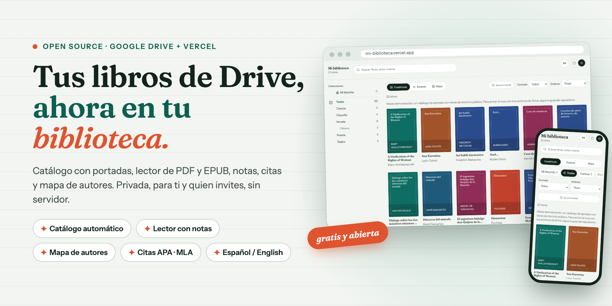
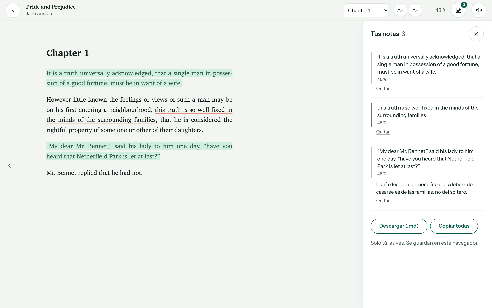
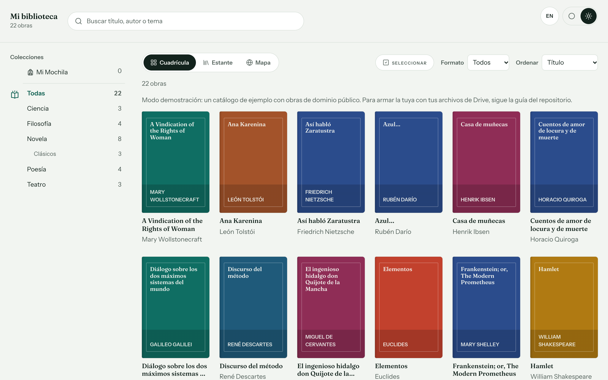
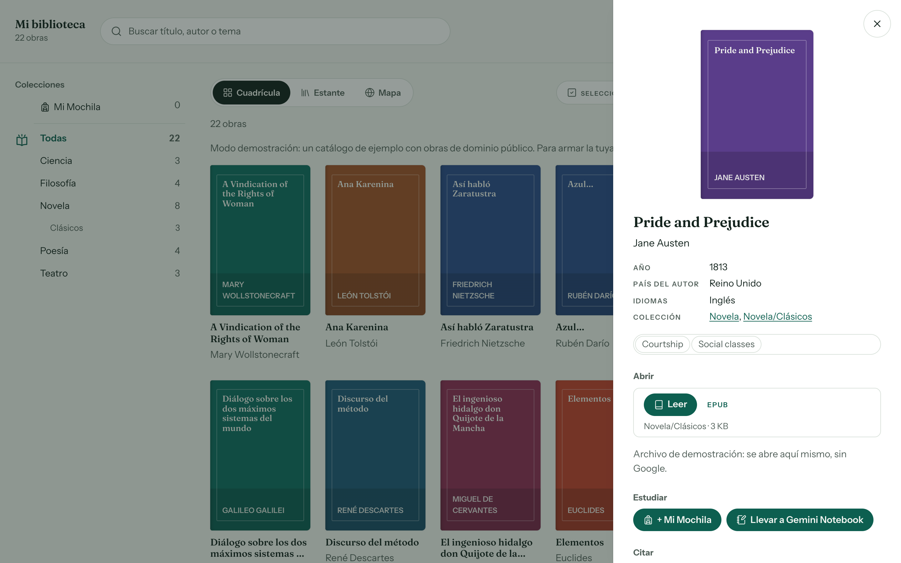
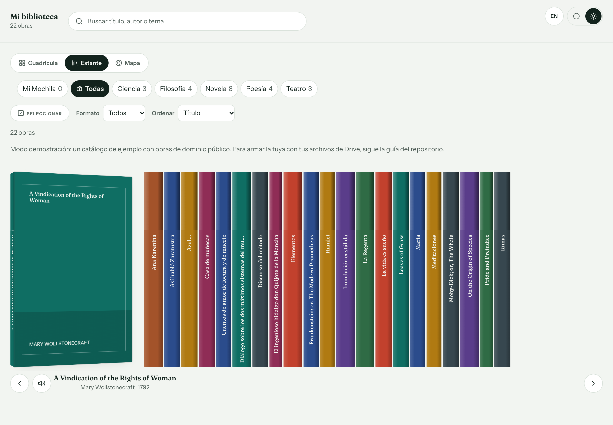
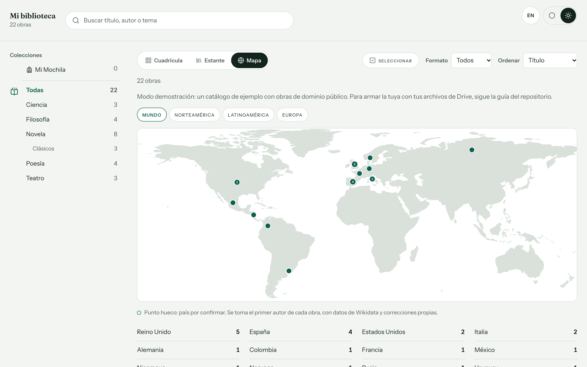
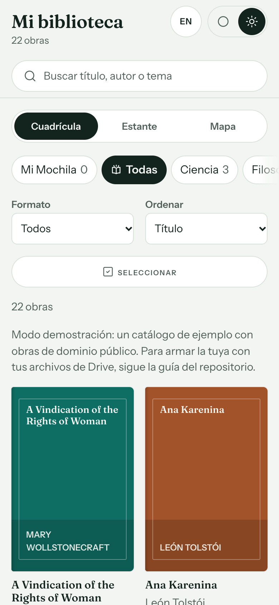
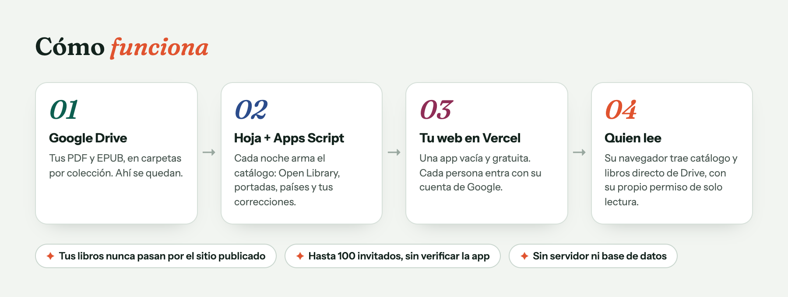

<p align="center">
  
</p>

<h1 align="center">Arma tu biblioteca digital</h1>

<p align="center">
  <b>Convierte los libros que guardas en Google Drive en una biblioteca privada en la web.</b><br>
  Catálogo con portadas, lector de PDF y EPUB, notas, citas y mapa de autores — gratis y de código abierto.
</p>

<p align="center">
  
  
  
  
  
  
  
</p>

<p align="center">
  <a href="https://arma-tu-biblioteca-digital.vercel.app"></a>
</p>

<p align="center">
  <a href="README.md">🇬🇧 Read in English</a> ·
  <a href="#-pruébalo-en-un-minuto">Pruébalo</a> ·
  <a href="#-funciones">Funciones</a> ·
  <a href="docs/es/guia.md">Guía paso a paso</a>
</p>

---

Tus libros ya están en Google Drive, pero Drive es un explorador de archivos, no una biblioteca.
**Arma tu biblioteca digital** convierte una carpeta de Drive en un catálogo de verdad, con portadas, un lector cómodo,
notas y citas, para ti y hasta 100 personas que invites. No hay servidor ni base de datos que mantener:
Drive guarda los libros, una hoja de cálculo con Apps Script arma el catálogo cada noche
y la web se publica gratis en Vercel.

<p align="center">
  
</p>

## ✨ Funciones

| | |
|---|---|
| 📚 **Catálogo automático** | Cada noche lee tus carpetas, junta los formatos de una misma obra y completa título, autor, año, temas y portada con Open Library. |
| 📖 **Lector integrado** | PDF (pdf.js) y EPUB, MOBI, AZW3, FB2 (foliate-js), con tamaño de letra, índice y avance de lectura. |
| 🖍️ **Notas** | Resalta, subraya y anota; exporta tus notas en Markdown. |
| 🎒 **Mi Mochila** | Lista de lectura personal de hasta 30 textos, que cada lector puede sincronizar en su propio Drive. |
| 🎓 **Citas** | APA 7, Chicago, MLA 9, Harvard, Vancouver e IEEE, listas para copiar. |
| 🗺️ **Mapa de autores** | Las obras agrupadas por el país del autor, con datos de Wikidata. |
| 📐 **Tres vistas** | Cuadrícula con portadas, estante con lomos y mapa. Búsqueda por título, autor o tema. |
| ✏️ **Correcciones en una hoja** | Corrige títulos, autores o portadas, u oculta obras, desde una hoja de cálculo: sin código. |
| 🔒 **Privada desde el diseño** | Acceso de solo lectura a Drive; nada de tu biblioteca pasa por el sitio publicado. |
| 🌐 **Bilingüe** | Interfaz en español e inglés, con botón para cambiar. Se instala como app (PWA). |

## 📸 Capturas

<table>
  <tr>
    <td width="50%"><p align="center"><b>Catálogo</b> — colecciones, filtros y portadas</p></td>
    <td width="50%"><p align="center"><b>Ficha</b> — leer, agregar a Mi Mochila, citar</p></td>
  </tr>
  <tr>
    <td width="50%"><p align="center"><b>Estante</b> — recorre los lomos como en un librero</p></td>
    <td width="50%"><p align="center"><b>Mapa</b> — de dónde son tus autores</p></td>
  </tr>
</table>

<p align="center">
  <br>
  <sub>También funciona en el celular y se instala como app.</sub>
</p>

## ⚙️ Cómo funciona

<p align="center">
  
</p>

- **Tú decides quién entra:** hasta 100 personas invitadas con su cuenta de Google, en el modo de prueba de Google Cloud (sin verificar la app).
- **Solo lectura:** la web pide `drive.readonly`; no puede cambiar nada en tu Drive.
- **Nada de tu biblioteca pasa por el sitio publicado:** cada navegador lee el catálogo y los libros directo de Drive, con el permiso de quien lee.

## 🚀 Pruébalo en un minuto

**Lo más rápido:** abre la **[demo en vivo](https://arma-tu-biblioteca-digital.vercel.app)**, sin instalar nada. Cambia a español con el botón ES.

Para correrla en tu computadora (no necesitas cuenta de Google: arranca en modo demostración con obras de dominio público), necesitas [Node.js 20+](https://nodejs.org).

```bash
git clone https://github.com/USUARIO/arma-tu-biblioteca-digital.git
cd arma-tu-biblioteca-digital/web
npm install
npm run dev
```

Abre <http://127.0.0.1:5173> y abre *El ingenioso hidalgo don Quijote* o *Pride and Prejudice* en el lector.

## 🧭 Arma la tuya

Sigue la **[guía paso a paso](docs/es/guia.md)**: carpeta en Drive, hoja de cálculo y Apps Script, Google Cloud y OAuth,
publicación en Vercel, invitaciones, correcciones, portadas, duplicados, Mi Mochila y notas.
Incluye todos los códigos y no supone que sepas programar.

## 🛠️ Estructura

```
apps-script/   código para pegar en el editor de Apps Script de tu hoja
  config.gs      ← lo único que editas: IDs, idioma, hora nocturna…
  inventario.gs  inventario de Drive y limpieza de archivos basura
  catalogo.gs    catálogo, correcciones, portadas, países, reorganización
web/           la aplicación web (React + Vite)
  .env.example   ← copia a .env y llena: ID de cliente, nombre, idioma…
  demo/          catálogo y archivos de demostración (dominio público)
  scripts/       permitir.mjs (invitados), crear-demo.mjs, crear-iconos.mjs
docs/          guías en español (es/) e inglés (en/), imágenes (img/)
```

## 🔐 Privacidad y uso responsable

Este proyecto no aloja ni distribuye libros: cada quien usa su propio Drive.
Lee la [nota de privacidad y uso responsable](PRIVACIDAD.md).

## 🤝 Contribuir

Reportes de errores, mejoras a la guía e interfaces en otros idiomas son muy
bienvenidos. Lee [CONTRIBUTING.md](CONTRIBUTING.md) y busca los issues con la
etiqueta [`good first issue`](../../issues?q=is%3Aissue+is%3Aopen+label%3A%22good+first+issue%22).

## 📚 Citar este proyecto

Si lo usas en un trabajo académico, usa el botón **Cite this repository** de
GitHub (lee [CITATION.cff](CITATION.cff)).

## 🙏 Créditos

[pdf.js](https://mozilla.github.io/pdf.js/) (Apache 2.0), [foliate-js](https://github.com/johnfactotum/foliate-js) (MIT),
tipografías [Fraunces](https://github.com/undercasetype/Fraunces) e [Instrument Sans](https://github.com/Instrument/instrument-sans) (SIL OFL),
datos de [Open Library](https://openlibrary.org) y [Wikidata](https://www.wikidata.org).

## 📄 Licencia

[MIT](LICENSE) © 2026 Francisco Vazquez.
