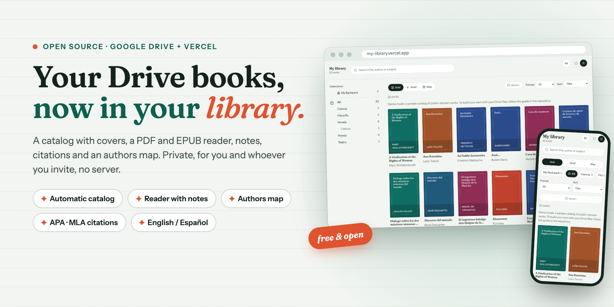
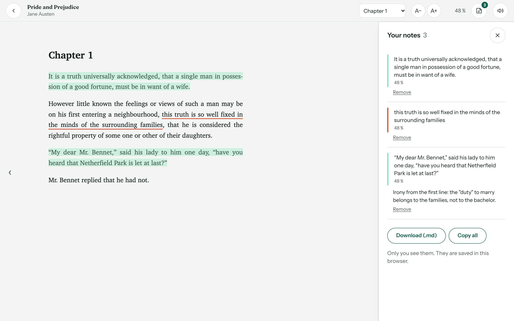
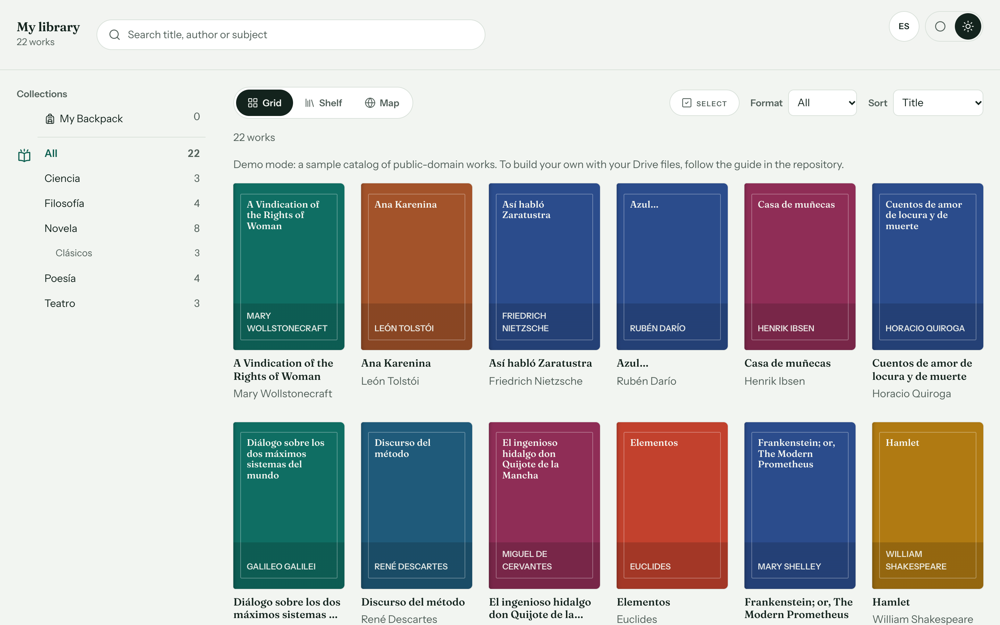
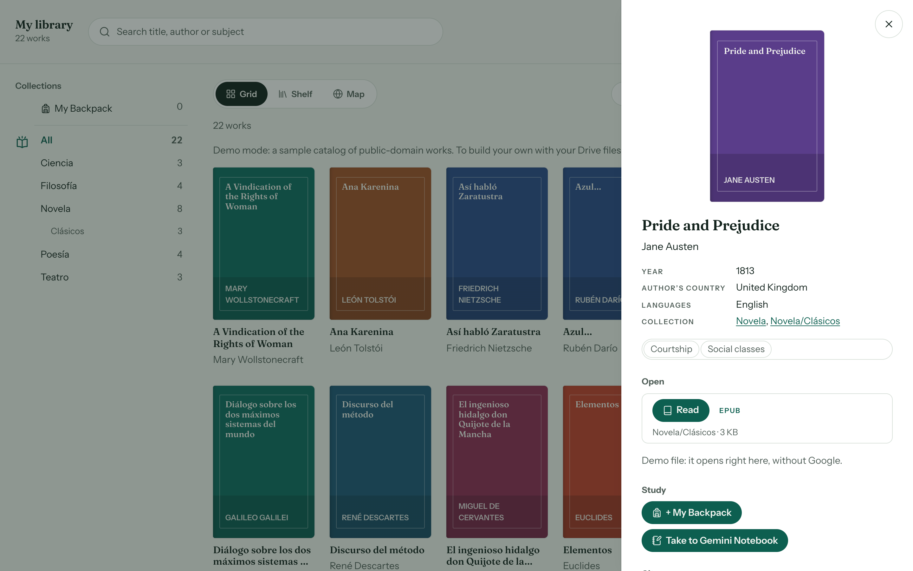
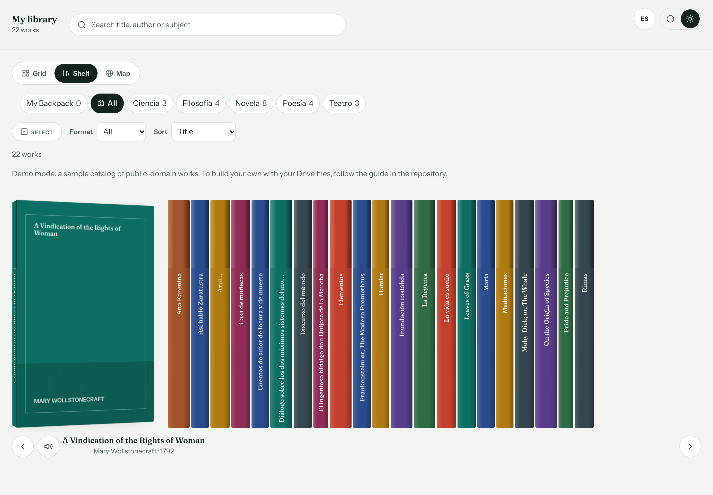
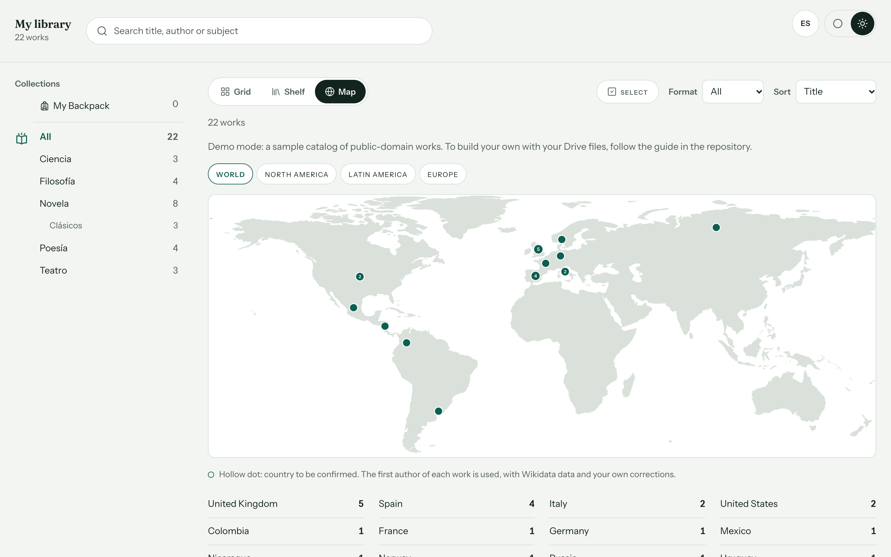
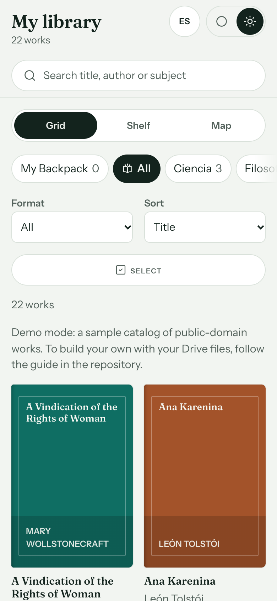
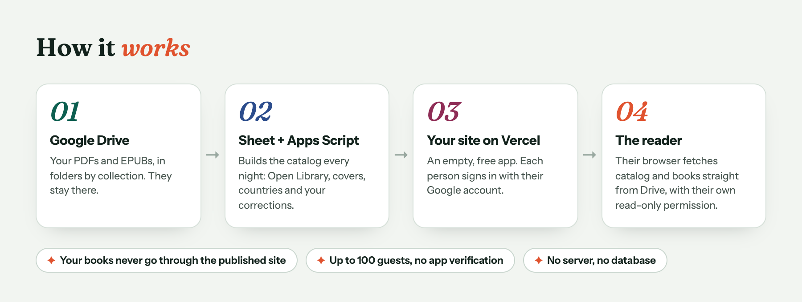

<p align="center">
  
</p>

<h1 align="center">Build your digital library</h1>

<p align="center">
  <b>Turn the books you keep in Google Drive into a private library on the web.</b><br>
  Catalog with covers, PDF and EPUB reader, notes, citations and an authors map — free and open source.
</p>

<p align="center">
  
  
  
  
  
  
  
</p>

<p align="center">
  <a href="https://arma-tu-biblioteca-digital.vercel.app"></a>
</p>

<p align="center">
  <a href="README.es.md">🇪🇸 Leer en español</a> ·
  <a href="#-try-it-in-a-minute">Try it</a> ·
  <a href="#-features">Features</a> ·
  <a href="docs/en/guide.md">Step-by-step guide</a>
</p>

---

Your books are already in Google Drive, but Drive is a file browser, not a library.
**Build your digital library** turns a Drive folder into a real catalog with covers, a comfortable reader,
notes and citations, for you and up to 100 people you invite. There is no server or database to maintain:
Drive stores the books, a spreadsheet with Apps Script builds the catalog every night,
and the web app is deployed for free on Vercel.

<p align="center">
  
</p>

## ✨ Features

| | |
|---|---|
| 📚 **Automatic catalog** | Every night it reads your folders, groups formats into works and fills in title, author, year, subjects and cover from Open Library. |
| 📖 **Built-in reader** | PDF (pdf.js) and EPUB, MOBI, AZW3, FB2 (foliate-js), with font size, table of contents and reading progress. |
| 🖍️ **Notes** | Highlight, underline and annotate; export your notes as Markdown. |
| 🎒 **My Backpack** | A personal reading list of up to 30 texts, optionally synced to each reader's own Drive. |
| 🎓 **Citations** | APA 7, Chicago, MLA 9, Harvard, Vancouver and IEEE, ready to copy. |
| 🗺️ **Authors map** | Works grouped by the author's country, with data from Wikidata. |
| 📐 **Three views** | Grid with covers, a shelf of spines and the map. Search by title, author or subject. |
| ✏️ **Corrections in a sheet** | Fix titles, authors, covers or hide works from a spreadsheet — no code. |
| 🔒 **Private by design** | Read-only Drive access; nothing from your library goes through the published site. |
| 🌐 **Bilingual** | Spanish and English interface, with a switch. Installable as an app (PWA). |

## 📸 Screenshots

<table>
  <tr>
    <td width="50%"><p align="center"><b>Catalog</b> — collections, filters and covers</p></td>
    <td width="50%"><p align="center"><b>Work card</b> — read, add to your Backpack, cite</p></td>
  </tr>
  <tr>
    <td width="50%"><p align="center"><b>Shelf</b> — browse spines like a real bookcase</p></td>
    <td width="50%"><p align="center"><b>Map</b> — where your authors come from</p></td>
  </tr>
</table>

<p align="center">
  <br>
  <sub>Works on phones too, and installs as an app.</sub>
</p>

## ⚙️ How it works

<p align="center">
  
</p>

- **You decide who gets in:** up to 100 people invited with their Google account, using Google Cloud's testing mode (no app verification).
- **Read-only:** the web app asks for `drive.readonly`; it cannot change anything in your Drive.
- **Nothing from your library goes through the published site:** each browser reads the catalog and the books straight from Drive, with the reader's own permission.

## 🚀 Try it in a minute

**Fastest:** open the **[live demo](https://arma-tu-biblioteca-digital.vercel.app)** — nothing to install. The interface switches to Spanish with the ES button.

To run it on your computer (no Google account needed: it starts in demo mode with public-domain works), you need [Node.js 20+](https://nodejs.org).

```bash
git clone https://github.com/USER/arma-tu-biblioteca-digital.git
cd arma-tu-biblioteca-digital/web
npm install
npm run dev
```

Open <http://127.0.0.1:5173> and open *Pride and Prejudice* or *Don Quijote* in the reader.

## 🧭 Build yours

Follow the **[step-by-step guide](docs/en/guide.md)**: Drive folder, spreadsheet and Apps Script, Google Cloud and OAuth,
deploying to Vercel, invitations, corrections, covers, duplicates, My Backpack and notes.
It includes every piece of code and does not assume you know how to program.

## 🛠️ Project structure

```
apps-script/   code to paste into your sheet's Apps Script editor
  config.gs      ← the only file you edit: IDs, language, nightly hour…
  inventario.gs  Drive inventory and junk-file clean-up
  catalogo.gs    catalog, corrections, covers, countries, reorganization
web/           the web app (React + Vite)
  .env.example   ← copy to .env and fill in: client ID, name, language…
  demo/          demo catalog and files (public domain)
  scripts/       permitir.mjs (invitees), crear-demo.mjs, crear-iconos.mjs
docs/          guides in Spanish (es/) and English (en/), images (img/)
```

## 🔐 Privacy and responsible use

This project does not host or distribute books: everyone uses their own Drive.
Read the [privacy and responsible-use note](PRIVACIDAD.md).

## 🤝 Contributing

Bug reports, guide improvements and new interface languages are very welcome.
Read [CONTRIBUTING.md](CONTRIBUTING.md) and look for issues labeled
[`good first issue`](../../issues?q=is%3Aissue+is%3Aopen+label%3A%22good+first+issue%22).

## 📚 Cite this project

If you use it in academic work, use the **Cite this repository** button on GitHub
(it reads [CITATION.cff](CITATION.cff)).

## 🙏 Credits

[pdf.js](https://mozilla.github.io/pdf.js/) (Apache 2.0), [foliate-js](https://github.com/johnfactotum/foliate-js) (MIT),
typefaces [Fraunces](https://github.com/undercasetype/Fraunces) and [Instrument Sans](https://github.com/Instrument/instrument-sans) (SIL OFL),
data from [Open Library](https://openlibrary.org) and [Wikidata](https://www.wikidata.org).

## 📄 License

[MIT](LICENSE) © 2026 Francisco Vazquez.
